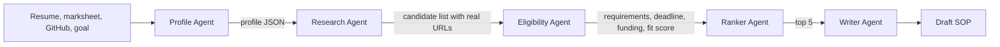

# AI Scholarship Finder

TetraNoodle AI Hackathon 2026. Five Python agents read a student's documents, search the web, check official
pages, rank the best matches and draft a statement of purpose. Streamlit website on top.

## Run it

```
pip install -r requirements.txt
export GROQ_API_KEY=your_key        # PowerShell: $env:GROQ_API_KEY="your_key"
export TAVILY_API_KEY=your_key      # optional, DuckDuckGo is used without it
streamlit run app.py
```

Keys can also be pasted in the sidebar. No key is stored in the repo.

## How the agents work



| Agent | Job | Tools |
|---|---|---|
| Profile | Builds a profile from resume, marksheet and public GitHub repos | PDF reader, GitHub API, LLM |
| Research | Plans queries, searches, picks real programs from the results | Tavily or DuckDuckGo, LLM |
| Eligibility | Reads each official page and compares it to the profile | HTTP fetch, LLM |
| Ranker | Picks the top 5, weighting funding because the student needs it | LLM |
| Writer | Drafts a statement of purpose for one chosen opportunity | LLM |

Agents share one state dict. Each agent reads what the previous one wrote.

## Trust and sources

- Every URL comes from a real search result. The model only picks result numbers, it never writes links.
- The eligibility agent is told to answer only from the page text and to say "not found on page" otherwise.
- Each result shows whether it was checked against the official page or only a search snippet.
- The writer uses profile facts only and leaves [PLACEHOLDER] where something is missing.
- Drafts are never submitted anywhere.

## Failure handling

- Search: Tavily fails or returns nothing, DuckDuckGo takes over.
- Fewer than 10 candidates: the research agent runs broader searches.
- Page cannot be fetched: the eligibility agent uses the search snippet and marks it.
- Rate limit or API error: retries with backoff, then switches to the fallback model.
- Invalid JSON from the model: re-asks up to three times.
- One opportunity fails: it is skipped, the run continues.
- Ranking call fails: falls back to fit score order.

## New student profile

Nothing is hardcoded to one student. Upload a different resume or paste text, change the goal, run again.
