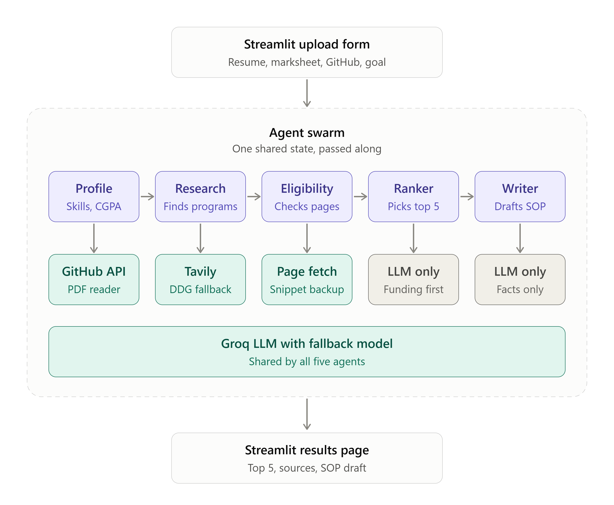

<div align="center">

# 🎓 AI Scholarship Finder

**Upload a resume. Five AI agents search the web, read the official pages, and show where you can apply.**


</div>

---

## Overview

Built for the **TetraNoodle AI Hackathon 2026**. Five Python agents read a student's documents, search the web, check official pages, rank the best matches and draft a statement of purpose. A Streamlit website sits on top.

Nothing is hardcoded to one student. Upload a different resume or paste text, change the goal, and run it again.

## Architecture

<p align="center">
  
</p>

The agents share one state dict. Each agent reads what the previous one wrote, and all five use the same Groq model, with a fallback model if it fails.

## The five agents

| # | Agent | Job | Tools |
|---|-------|-----|-------|
| 1 | **Profile** | Builds a profile from the resume, marksheet and public GitHub repos | PDF reader, GitHub API, LLM |
| 2 | **Research** | Plans queries, searches, and picks real programs from the results | Tavily (DuckDuckGo fallback), LLM |
| 3 | **Eligibility** | Reads each official page and compares it to the profile | HTTP fetch (snippet backup), LLM |
| 4 | **Ranker** | Picks the top 5, weighting funding because the student needs it | LLM only |
| 5 | **Writer** | Drafts a statement of purpose for one chosen opportunity | LLM only |

## Quick start

```bash
pip install -r requirements.txt
streamlit run app.py
```

Set your keys before running, or paste them in the app sidebar.

| Shell | Command |
|-------|---------|
| Windows cmd | `set GROQ_API_KEY=your_key` |
| PowerShell | `$env:GROQ_API_KEY="your_key"` |
| macOS / Linux | `export GROQ_API_KEY=your_key` |

`TAVILY_API_KEY` works the same way and is optional. Without it, DuckDuckGo is used. No key is stored in the repo.

## Trust and sources

- **Real links only.** Every URL comes from a real search result. The model only picks result numbers, it never writes links.
- **Page text only.** The eligibility agent answers from the page text and says "not found on page" otherwise.
- **Source labels.** Each result shows whether it was checked against the official page or only a search snippet.
- **No invented facts.** The writer uses profile facts only and leaves `[PLACEHOLDER]` where something is missing.
- **Nothing is submitted.** Drafts stay on your screen until you copy or download them.

## Failure handling

| What goes wrong | What happens |
|-----------------|--------------|
| Tavily fails or returns nothing | DuckDuckGo takes over |
| Fewer than 10 candidates | The research agent runs broader searches |
| Page cannot be fetched | The eligibility agent uses the search snippet and marks it |
| Rate limit or API error | Retries with backoff, then switches to the fallback model |
| Invalid JSON from the model | Re-asks up to three times |
| One opportunity fails | It is skipped and the run continues |
| Ranking call fails | Falls back to fit score order |

## Project structure

```
.
├── .streamlit/
│   └── config.toml        # theme
├── docs/
│   └── architecture.png   # diagram used above
├── app.py                 # Streamlit app
├── agents.py              # the five agents
├── tools.py               # LLM wrapper, search, page fetch, GitHub, PDF
├── style.py               # CSS and HTML builders
├── requirements.txt
└── README.md
```